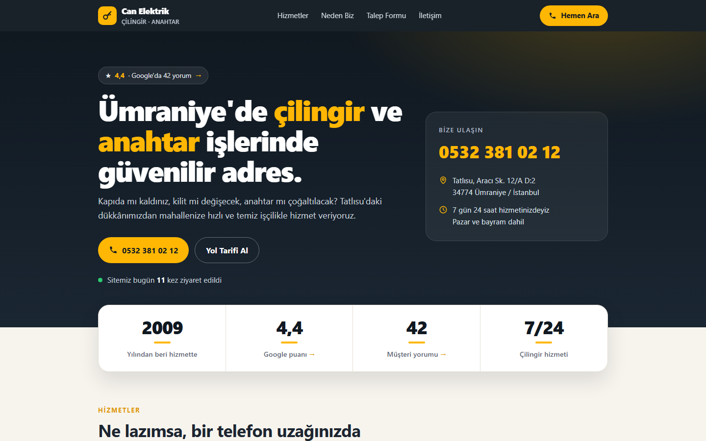
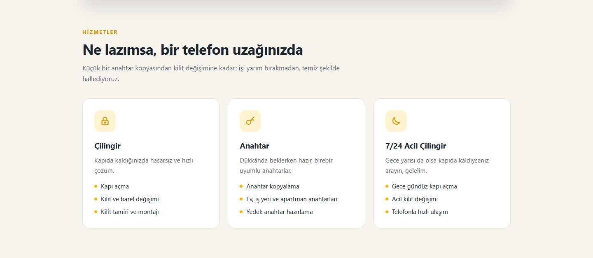
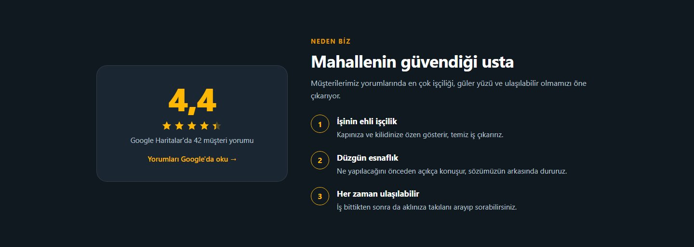
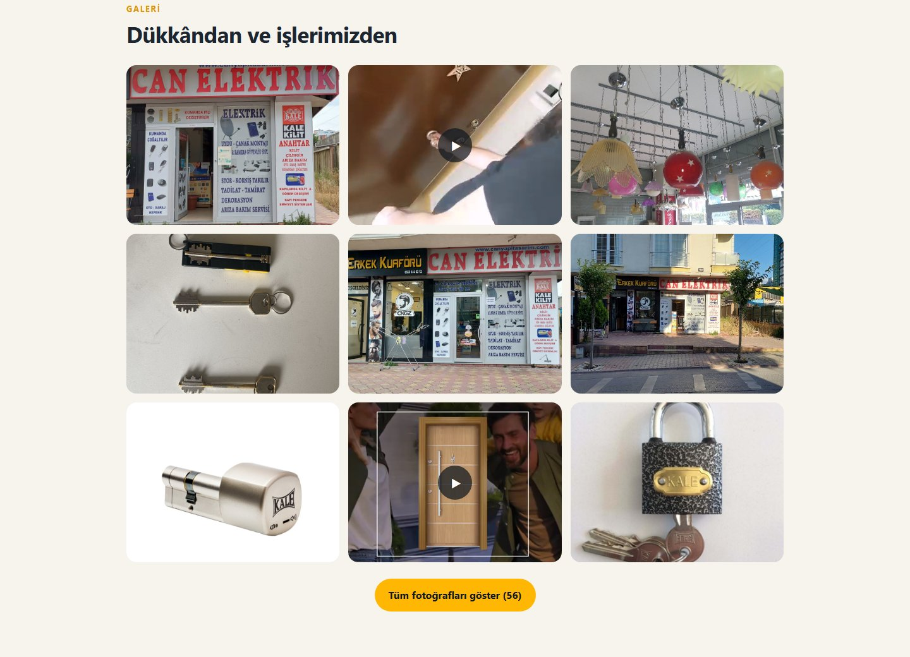
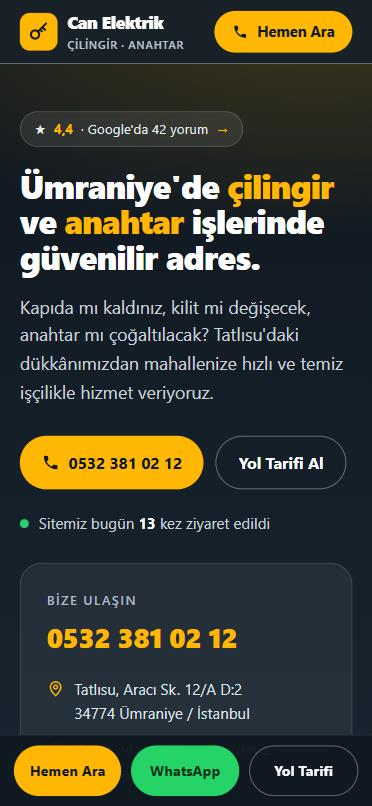
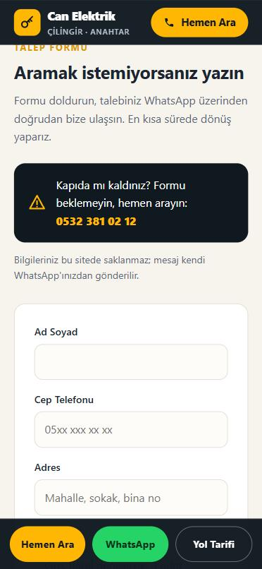
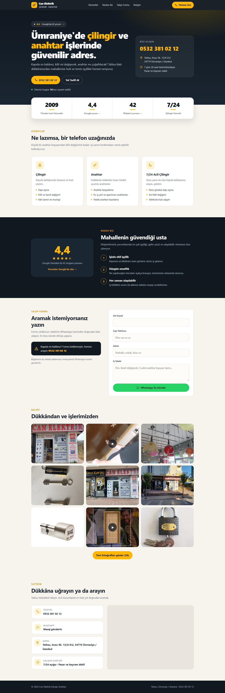
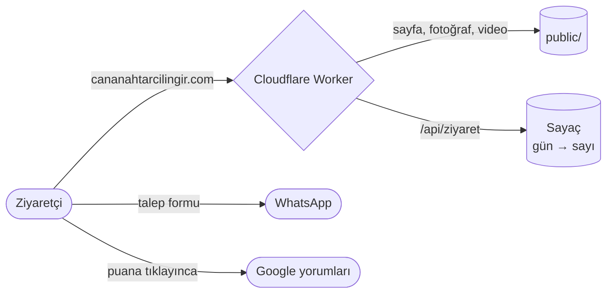

<div align="center">

# 🔑 Can Elektrik Çilingir Anahtar

**Ümraniye Tatlısu'nun 2009'dan beri çilingiri — artık internette de.**

[](https://cananahtarcilingir.com)
[](https://workers.cloudflare.com)
[](#-gizlilik-ve-güvenlik)

<br>



</div>

---

## ✨ Bir bakışta

| | |
| --- | --- |
| 📞 **Tek dokunuşla arama** | Telefonda ekranın altında hep duran *Hemen Ara · WhatsApp · Yol Tarifi* çubuğu |
| 💬 **WhatsApp talep formu** | Aramak istemeyen müşteri formu doldurur, talep hazır mesaj olarak WhatsApp'a düşer. Sunucuda hiçbir şey saklanmaz |
| ⭐ **Google puanı** | 4,4 puan (beşinci yıldız tam %40 dolu); tıklayınca doğrudan Google'daki yorumlar açılır |
| 📈 **Canlı ziyaret sayacı** | *"Sitemiz bugün X kez ziyaret edildi"* — gerçek sayı, her gece 00:00'da sıfırlanır |
| 🖼️ **56'lık galeri** | Google Haritalar'daki fotoğraf ve videoların tamamı; büyük görünüm, ok tuşlarıyla gezinme |
| 🌙 **7/24** | Gece yarısı da kapıda kalana hizmet |
| 📱 **Mobil öncelikli** | Müşterilerin çoğu telefondan gelir; her ekran telefonda denendi |

---

## 📸 Ekranlar

<table>
  <tr>
    <td align="center" width="50%"><br><sub><b>Hizmetler</b> — çilingir, anahtar, 7/24 acil</sub></td>
    <td align="center" width="50%"><br><sub><b>Neden biz</b> — Google puanı, tıklanınca yorumlara gider</sub></td>
  </tr>
  <tr>
    <td align="center" colspan="2"><br><sub><b>Galeri</b> — ilk 9 kare, kalanı tek tıkla açılır; videolar sayfada oynar</sub></td>
  </tr>
</table>

<table>
  <tr>
    <td align="center"><br><sub>Telefonda ilk ekran</sub></td>
    <td align="center"><br><sub>WhatsApp'a düşen talep formu</sub></td>
  </tr>
</table>

<details>
<summary><b>Sayfanın tamamını gör</b></summary>
<br>

</details>

---

## 🛠️ Nasıl çalışıyor



- **Site**, `public/` klasöründeki düz HTML/CSS/JS dosyalarından ibaret. Derleme, çerçeve, veritabanı yok; açılması hızlı, bozulacak parçası az.
- **Sayaç** tek bir Cloudflare Durable Object. Gün başına tek satır tutuyor (`2026-11-17 → 42`), o kadar. Sadece kendi sitemizden gelen istekleri sayıyor; başka sitelerden şişirilemiyor.
- **Talep formu** sunucuya hiç uğramıyor: bilgiler müşterinin kendi WhatsApp'ında hazır mesaj olarak açılıyor.

---

## 🧭 Yolculuk

Bu site tek bir oturumda, Google Haritalar sayfasındaki birkaç satırlık bilgiden çıkıp canlıya kadar geldi:

1. **Fikir** — Haritalar'daki işletme bilgisinden (adres, telefon, 42 yorum, 4,4 puan) koyu lacivert + kehribar renkli tek sayfalık bir tasarım.
2. **Odak** — Elektrik işleri çıkarıldı; site sadece **çilingir ve anahtar** anlatıyor.
3. **Rakamlar** — "2009'dan beri", Google puanı ve yorum sayısıyla sayarak gelen istatistik bandı.
4. **WhatsApp formu** — e-postaya düşen klasik form yerine, çilingirde hızın önemli olduğu için WhatsApp'a düşen form seçildi.
5. **Galeri** — Haritalar'daki 62 öğenin hepsi tarandı. İşletmeye ait **56** fotoğraf ve video siteye kondu; müşterilerin yüklediği fotoğraflar izinsiz kullanılmasın diye dışarıda bırakıldı.
6. **Alan adı** — `cananahtarcilingir.com` Cloudflare'den alındı, site Cloudflare Workers'a yüklendi, HTTPS otomatik.
7. **Sayaç** — önce "günde bir kişi bir kez", sonra her girişte artan haliyle canlı ziyaret sayacı.
8. **İnce ayar** — kısmi dolu beşinci yıldız, Google yorumlarına giden linkler, 7/24 çalışma saatleri.

---

## 🔒 Gizlilik ve güvenlik

- **Çerez yok, takip kodu yok, reklam yok.** Ziyaretçinin cihazına hiçbir şey kaydedilmiyor.
- **Kişisel veri toplanmıyor.** Sayaç IP ya da kimlik tutmuyor; form bilgileri hiçbir sunucuda saklanmıyor.
- Güvenlik başlıkları (`public/_headers`): sayfanın başka sitelere gömülmesi engelli, kamera/mikrofon/konum izni kapalı.
- Müşteri fotoğrafları (`musteri-fotograflari/`, `yukleyeni-belirsiz/`) `.gitignore` ile bu deponun dışında tutuluyor.

---

## 📁 Klasörler

```
├── public/              # Sitenin kendisi (olduğu gibi yayınlanır)
│   ├── index.html       # Tüm sayfa: tasarım, metinler, form, sayaç satırı
│   ├── galeri.js        # Galerideki 56 fotoğraf/videonun listesi
│   ├── _headers         # Güvenlik başlıkları
│   └── fotograflar/     # Galeri dosyaları
├── src/index.js         # Ziyaret sayacı (Cloudflare Worker + Durable Object)
├── wrangler.jsonc       # Cloudflare ayarları: alan adları, sayaç
└── docs/                # Bu sayfadaki ekran görüntüleri
```

---

## 🚀 Çalıştırma ve yayınlama

```bash
npm install        # bir kez
npm run dev        # http://localhost:8787 — yerel sayaç canlıdakinden ayrıdır
```

```bash
npx wrangler login # bir kez, tarayıcıdan Cloudflare izni
npm run deploy     # canlıya yükler
```

### Sık değişen yerler

| Ne | Nerede |
| --- | --- |
| Telefon / WhatsApp | `public/index.html` içinde `905323810212` geçen yerler |
| Google puanı, yorum sayısı | `public/index.html` → `STATS` listesi, puan kartı, üstteki rozet (yıldız doluluğu: `kismiYildiz`) |
| Çalışma saatleri | `public/index.html` → iletişim kartı, *Çalışma Saatleri* satırı, `openingHoursSpecification` |
| Galeri | `public/galeri.js` |

---

## ✅ Yapılacaklar

- [ ] Cloudflare'de **Her Zaman HTTPS Kullan** ayarını aç
- [ ] Google İşletme Profili'nde saatleri **7/24** yap (şu an Pzt 09:00 görünüyor)
- [ ] Google İşletme Profili'ne site adresini ekle
- [ ] Talep formunu telefondan gerçek bir mesajla dene
- [ ] Dükkânın güncel fotoğraflarını çekip galeriye ekle

<div align="center">
<br>
<sub>Tatlısu, Aracı Sk. 12/A D:2, 34774 Ümraniye / İstanbul · <a href="tel:+905323810212">0532 381 02 12</a></sub>
</div>
